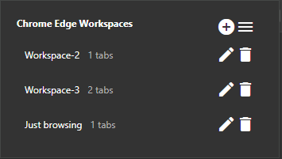
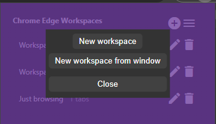
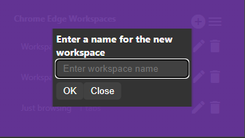
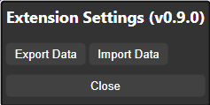

#  Edge Workspaces

**Edge Workspaces** is an extension that replicates the Microsoft Edge Workspaces feature. It allows you to save the state of a window, including all open tabs, and reopen it later as a workspace.

## Key Features

- **Automatic Saving**: The extension automatically saves your workspace as you work, eliminating the need to manually save open tabs.
- **Import/Export**: Workspaces can be exported to a file and imported later on another device.
- **Workspaces copied as bookmarks**: Workspaces can be saved as bookmarks to allow for easier cross-platform access.
- **Internal Tab Exclusion**: Internal tabs, such as the new tab page, settings, or extensions, are not saved to workspaces.
- **Keep in sync:** Your workspaces stay in sync across computers via Google sync
 
## Usage

### Creating a Workspace

1. Open the extension popup by clicking the icon in the toolbar (pinning the extension is recommended).
2. Click the "+" icon to open the new workspace modal.
3. Select either "New workspace" or "New workspace from window".
4. Enter a name for the workspace.
5. Click "OK".
6. A new browser window will open with the New Tab page.
7. All tabs in the current window will be saved to the workspace as you work.
8. Close the window when finished.

### Opening a Workspace

1. Open the extension popup.
2. Click on a workspace to open it.
3. The saved tabs will be opened in a new browser window.

### Managing Workspaces

- Click the trashcan icon to delete a workspace.
- Click the pencil icon to rename a workspace.
- Use Tab to focus a toolbar or row action, then press Enter or Space to activate it.

### Reordering Workspaces

1. Select the **Reorder workspaces** icon in the Chrome popup or Firefox sidebar.
2. Drag a workspace by its handle, or focus its **Move up** or **Move down** control and press Enter or Space.
3. Select the reorder icon again to exit reorder mode. Each move saves immediately.

Custom order is saved per browser profile and travels with workspace exports. New workspaces appear at the end. Turn on **Enable debug tools** in Settings to show the position confirmation after each move.

### Saving Workspaces as Bookmarks

- Ensure "Save workspaces to bookmarks" option is checked in Settings.
- Workspaces will now be copied to `Other bookmarks -> Edge Workspaces (read-only) -> [Workspace Name]`.
- Note that changes to the bookmarks will **not** be reflected in the workspaces themselves, as they are just a copy. 
- When installing a new version, make sure to open old workspaces at least once to allow for them to be saved as bookmarks.

### Importing/Exporting Workspaces

1. Open the extension popup.
2. Click the hamburger icon to open the settings window.
3. Click "Export" to save all workspaces to a file.
4. Click "Import" to load workspaces from a file.

## Images

## Install
### Chrome Web Store

### Firefox Addon Store

## Contribution
Suggestions and pull requests are welcomed!

## Development
1. Clone the repository
2. Run `npm install`
3. Run `npm run build` to build the extension
4. Load the extension in Chrome using the steps below
5. Run `npm run watch` to automatically rebuild the extension when changes are made

### Chrome
In VS Code, start **Run npm watch** to rebuild `build/chrome` as you edit. Use **Launch Chrome with Edge Workspaces** to open the popup in a dedicated Chrome profile that keeps the extension installed between sessions.

For a fresh dev profile, open `chrome://extensions` in the launched Chrome window, enable **Developer mode**, then click **Load unpacked** and select `build/chrome`. On later launches, Chrome loads the extension from that directory automatically.

To reload automatically after successful watch builds, install [Extension Development – Auto Reloader](https://chromewebstore.google.com/detail/extension-development-aut/falghmjeljhgmccbpffloemnfnmikked) in that same profile. Start `npm run watch`, open Auto Reloader, and click **Run** with these values.

| Field | Value |
| --- | --- |
| Extension ID | `feehlkcbifmladjmmpkghfokcngfkkkp` |
| WebSocket server port | `3001` |
| Testing tab URL | `http://localhost:3001/` |

The testing URL fills the helper’s required field. Open the Edge Workspaces popup from the toolbar to try the rebuilt code. After restarting Chrome or the watcher, reconnect Auto Reloader. If it still displays **RUNNING**, click **Stop**, enter the values again, and click **Run**. For manifest changes, click **Reload** on the Edge Workspaces extension card.

### Firefox
Using VS Code, there are two tasks available for Firefox:
* `Run npm watch firefox` - Runs `npm run watch-firefox`
* `Launch Firefox with add-on` - Launches a new Firefox window with the extension loaded in debug mode
  * Firefox only supports temporary installation of addons in debug mode, so data will not be saved between sessions

## Manual Chrome Web Store Deploy

Run **Deploy Chrome Extension** from GitHub Actions to submit an update to the existing Chrome Web Store listing for review. Set a version in `package.json` higher than the last uploaded version. The workflow syncs the manifest version and creates `v<package.json version>.zip` with `manifest.json` at the archive root.

In the repository's **Settings → Secrets and variables → Actions**, add these **variables**.

- `CHROME_EXTENSION_ID` - The Chrome Web Store extension ID.
- `CHROME_PUBLISHER_ID` - The publisher ID from the Chrome Web Store developer dashboard.
- `CHROME_CLIENT_ID` - OAuth client ID for the Chrome Web Store API.

Add these **secrets** in the same settings area.

- `CHROME_CLIENT_SECRET` - OAuth client secret for the Chrome Web Store API.
- `CHROME_REFRESH_TOKEN` - OAuth refresh token with the `https://www.googleapis.com/auth/chromewebstore` scope.

## Credits
* Original extension icon made by [Yogi Aprelliyanto](https://www.flaticon.com/authors/yogi-aprelliyanto) from [Flaticon](https://www.flaticon.com/)
* This project was bootstrapped with [Chrome Extension CLI](https://github.com/dutiyesh/chrome-extension-cli)
